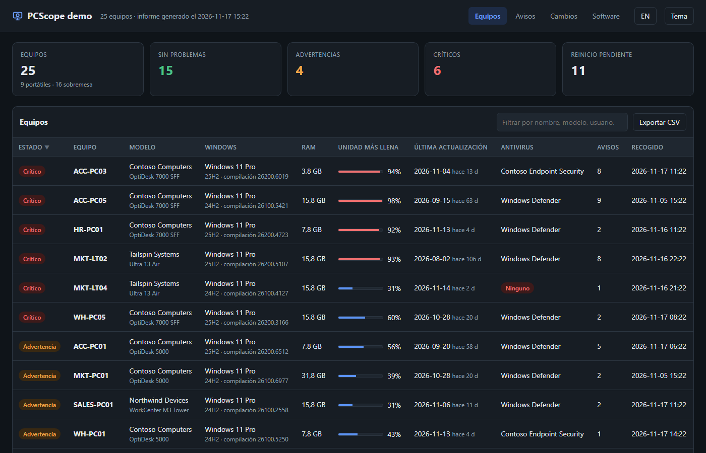
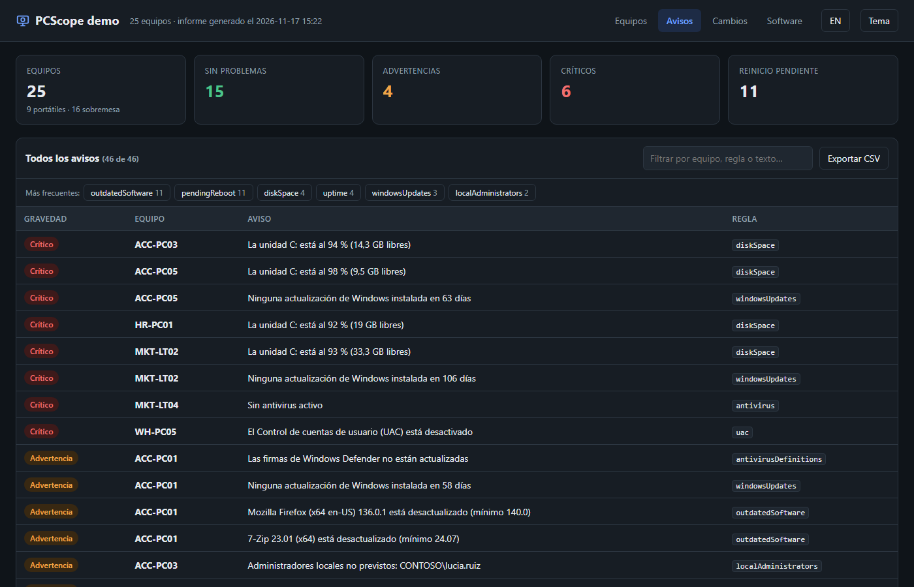
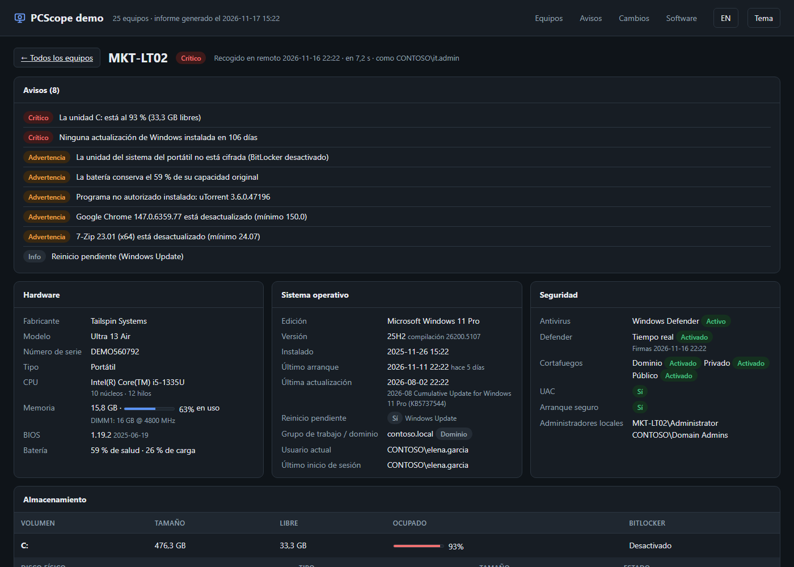
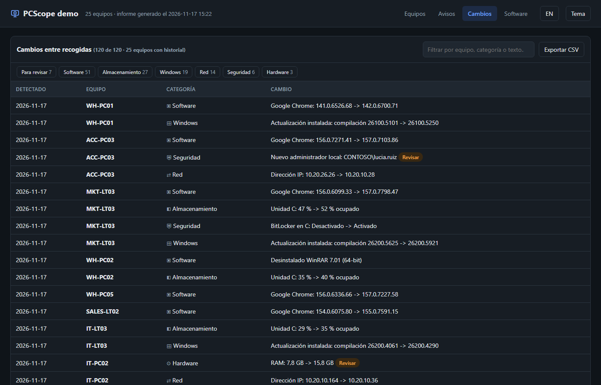

# PCScope

[](https://github.com/DavidGoRi/PCScope/actions/workflows/ci.yml)
[](https://davidgori.github.io/PCScope/?lang=es)
[](https://github.com/DavidGoRi/PCScope/releases/latest)


**Inventario y revisión del estado de los ordenadores Windows de una oficina pequeña, en un minuto y sin instalar nada.**

PCScope recoge, en modo solo lectura, el inventario de cada PC: hardware, discos, Windows, seguridad, red y programas instalados. Con eso genera un único panel HTML que destaca lo que necesita atención: un disco a punto de llenarse, un portátil sin cifrar, un equipo sin antivirus o con meses sin actualizar.

### ▶ [Abrir la demo en vivo](https://davidgori.github.io/PCScope/?lang=es)

La demo muestra una flota de 25 equipos ficticios, que GitHub Actions regenera cada semana. No hay que instalar nada: es el mismo archivo HTML que genera PCScope.

*Read in [English](README.md).*



## Por qué

Muchas pequeñas empresas no tienen una lista actualizada de sus ordenadores, y menos aún saben cuáles están en riesgo. Las herramientas comerciales de gestión remota (RMM) lo resuelven, pero cuestan dinero y hay que instalar un agente en cada equipo. PCScope solo usa lo que Windows ya trae:

- **No hay que instalar nada.** PowerShell 5.1 (incluido en todos los Windows 10/11) y un archivo HTML estático.
- **Solo lectura.** Nunca cambia ninguna configuración de los equipos que revisa.
- **Funciona sin permisos de administrador.** Cada sección se recoge por separado: si algo no se puede leer, se avisa y se sigue con el resto.
- **Funciona sin internet.** El panel es un único archivo sin librerías externas ni CDN: se puede abrir desde un USB o una carpeta compartida.

## Funciones

| Área | Qué recoge PCScope |
|---|---|
| Hardware | Fabricante, modelo, número de serie, BIOS, CPU, RAM y módulos de memoria, portátil o sobremesa |
| Almacenamiento | Volúmenes con espacio libre y estado de BitLocker; discos físicos con tipo, bus y estado SMART |
| Batería | Carga y salud (capacidad actual frente a la capacidad de fábrica) |
| Windows | Edición, versión y compilación, fecha de instalación, tiempo encendido, última actualización instalada, reinicio pendiente y su motivo |
| Seguridad | Antivirus (Defender y de terceros), si están activos y actualizados, perfiles del cortafuegos, UAC, arranque seguro y miembros del grupo de administradores locales |
| Red | Adaptadores activos con IPv4/IPv6, MAC, puerta de enlace, DNS y DHCP o IP fija |
| Usuarios | Usuario actual y último que inició sesión |
| Software | Programas instalados con versión, fabricante y fecha de instalación (desde el registro, evitando el lento `Win32_Product`) |

Además, el panel:

- Evalúa **18 reglas configurables** y marca cada equipo como *crítico*, *con advertencias* o *sin problemas* (ver [Reglas](#reglas)).
- Muestra una tabla de todos los equipos que se puede ordenar y filtrar, y una ficha completa de cada uno.
- Reúne **todos los avisos de la oficina** en un mismo sitio, con los problemas más frecuentes a un clic.
- Guarda el **historial** de cada equipo y muestra **qué ha cambiado** entre recogidas: programas instalados o actualizados, actualizaciones de Windows, discos que se llenan, administradores nuevos, ampliaciones de RAM… (ver [Historial y cambios](#historial-y-cambios)).
- **Exporta a CSV** desde cualquier vista, o todo de una vez desde la consola, listo para abrir en Excel.
- Responde a preguntas como *"¿qué equipos tienen todavía un Chrome antiguo?"* o *"¿dónde está instalado TeamViewer?"* con un buscador de programas en todos los equipos.
- Está en **español e inglés**: elige el idioma del navegador, tiene un botón ES/EN y se puede forzar con `?lang=es`.
- Tiene tema claro y oscuro y funciona en el móvil. Cada pestaña tiene su propio enlace (`#issues`, `#changes`, `#software`, `#device=NOMBRE`).





## Reglas

Las reglas están en [`rules.json`](rules.json), así que cada empresa puede ajustar los umbrales o desactivar comprobaciones sin tocar el código. Una regla con `"enabled": false`, o que no aparece en el archivo, no se evalúa.

| Regla | Por defecto | Nivel |
|---|---|---|
| `diskSpace` | Volumen ocupado por encima del 80 % / 90 % | advertencia / crítico |
| `diskHealth` | Disco físico que no indica *Healthy* (SMART) | crítico |
| `antivirus` | Sin antivirus activo (Defender o de terceros) | crítico |
| `antivirusDefinitions` | Firmas sin actualizar o con más de 7 días | advertencia |
| `firewall` | Algún perfil del cortafuegos desactivado | advertencia |
| `uac` | Control de cuentas de usuario (UAC) desactivado | crítico |
| `windowsUpdates` | Ninguna actualización instalada en 30 / 60 días | advertencia / crítico |
| `unsupportedWindows` | Compilación inferior a 22000 (Windows 10, sin soporte desde octubre de 2025) | crítico |
| `laptopEncryption` | Unidad del sistema de un portátil sin BitLocker | advertencia |
| `batteryHealth` | Batería por debajo del 60 % de su capacidad original | advertencia |
| `localAdministrators` | Administradores distintos de las cuentas permitidas | advertencia |
| `blockedSoftware` | Programas no autorizados (por ejemplo, clientes de torrent) | advertencia |
| `outdatedSoftware` | Programas por debajo de una versión mínima (Chrome, Firefox, 7-Zip, Notepad++) | advertencia |
| `staleInventory` | Inventario con más de 7 días | advertencia |
| `pendingReboot`, `uptime`, `memory`, `collectionErrors` | Reinicio pendiente, más de 14 días sin reiniciar, menos de 8 GB de RAM, secciones que no se pudieron leer | informativo |

Por ejemplo, para bloquear las herramientas de acceso remoto y exigir al menos 16 GB de RAM:

```json
"blockedSoftware": { "enabled": true, "level": "warning", "patterns": [ "uTorrent", "AnyDesk", "TeamViewer" ] },
"memory":          { "enabled": true, "level": "info", "minGB": 16 }
```

Las reglas se evalúan en PowerShell ([`src/Rules.ps1`](src/Rules.ps1)), no en el navegador, así que los mismos resultados se pueden obtener desde la consola:

```powershell
. .\src\Rules.ps1
$inventory = Get-Content .\output\data\PC01.json -Raw | ConvertFrom-Json
Get-PCScopeIssue -Inventory $inventory -RuleSet (Get-PCScopeRuleSet .\rules.json)
```

## Uso rápido

**Descarga** [la última versión](https://github.com/DavidGoRi/PCScope/releases/latest) (`PCScope-<versión>.zip`), descomprímela y ejecuta:

```powershell
Get-ChildItem -Recurse | Unblock-File   # Windows bloquea los archivos descargados de internet
powershell -ExecutionPolicy Bypass -File .\PCScope.ps1 -Open
```

O clona el repositorio:

```powershell
git clone https://github.com/DavidGoRi/PCScope.git
cd PCScope
powershell -ExecutionPolicy Bypass -File .\PCScope.ps1 -Open
```

El inventario se guarda en `output\data\<NOMBRE_DEL_EQUIPO>.json` y el panel en `output\report.html`. La consola también muestra un resumen (los mensajes de la consola están en inglés):

```
Collecting inventory of OFFICE-PC01...
Saved C:\PCScope\output\data\OFFICE-PC01.json (94 programs, 4 s)
Status: WARNING (2 issue(s))
  [warning] Unexpected local administrators: OFFICE-PC01\jsmith
  [info] Restart pending (Windows Update)
Dashboard: C:\PCScope\output\report.html
```

## Historial y cambios

Cada vez que se vuelve a recoger un equipo, su inventario anterior pasa a `data\history\<EQUIPO>\<fecha>.json`. Se conservan los 30 últimos; se cambia con `-HistoryLimit`, o `0` para desactivarlo. El panel compara cada inventario con el anterior y lista cada cambio con la fecha en que se detectó:

| Categoría | Cambios que detecta |
|---|---|
| Software | Programas instalados, desinstalados o actualizados |
| Windows | Actualizaciones mensuales (compilación), actualizaciones de versión, edición |
| Almacenamiento | Ocupación del disco que varía 5 puntos o más, volúmenes y discos añadidos o retirados, estado del disco |
| Seguridad | Antivirus instalado, desinstalado, activado o desactivado; cortafuegos; UAC; arranque seguro; BitLocker; administradores locales añadidos o quitados |
| Hardware | RAM, CPU, número de serie (¿equipo sustituido?), actualizaciones de BIOS, desgaste de la batería |
| Red / Usuarios | Dirección IP, adaptadores de red, usuario principal |

Los cambios que conviene revisar salen marcados con **Revisar**: seguridad que se debilita (nunca cuando se refuerza), administradores nuevos, hardware sustituido o un disco que pasa del 90 %.



La comparación es PowerShell normal, así que también funciona desde la consola:

```powershell
. .\src\History.ps1
$before = Get-Content .\output\data\history\PC01\20261110-093000.json -Raw | ConvertFrom-Json
$after  = Get-Content .\output\data\PC01.json -Raw | ConvertFrom-Json
Compare-PCScopeInventory -Previous $before -Current $after | Format-Table category, message, notable
```

## Exportar a CSV

- **Desde el panel:** cada vista tiene un botón *Exportar CSV* que descarga exactamente las filas que se ven, con el filtro aplicado y en el idioma elegido.
- **Desde la consola:** `-ExportCsv` crea `devices.csv`, `issues.csv`, `software.csv` y `changes.csv` en `<OutputPath>\export`:

```powershell
.\PCScope.ps1 -OutputPath \\servidor\it\pcscope -ReportOnly -ExportCsv
```

Los archivos están en UTF-8 con BOM y usan el separador de listas del idioma del sistema (`;` en español, `,` en inglés). Así, al abrirlos con doble clic, Excel los muestra bien, con tildes incluidas.

## Alertas por Telegram o correo

Con `-SendAlerts`, PCScope envía los avisos críticos **nuevos** (también las advertencias si pones `"minLevel": "warning"`) y los cambios marcados para revisar. Está pensado para ejecutarse solo, por ejemplo después de la recogida programada:

```powershell
.\PCScope.ps1 -OutputPath \\servidor\it\pcscope -ReportOnly -SendAlerts
```

```
PCScope - Contoso office - 2 new alert(s)

SALES-LT07
  [CRITICAL] Drive C: is 96% full (9.6 GB free)
ACC-PC03
  [REVIEW] New local administrator: CONTOSO\lucia.ruiz
```

- **Sin repeticiones:** las alertas enviadas se guardan en `alerts-state.json`. Si un problema se arregla, se olvida, y vuelve a avisar si reaparece.
- **Configuración:** copia [`alerts.example.json`](alerts.example.json) como `alerts.json` y activa Telegram (id del chat) y/o el correo (servidor SMTP, puerto, remitente y destinatarios). `alerts.json` está en `.gitignore`.
- **Las contraseñas no van en archivos:** el token del bot de Telegram y la contraseña SMTP se leen de las variables de entorno `PCSCOPE_TELEGRAM_TOKEN` y `PCSCOPE_SMTP_PASSWORD`.

## Recoger los datos de toda una oficina

PCScope admite dos formas de trabajar, que se pueden combinar. Las dos guardan un JSON por equipo en la misma carpeta, y el panel se genera con un solo comando:

| | **A. Recogida remota** | **B. Tarea programada** |
|---|---|---|
| Cómo | El equipo de IT ejecuta PCScope una vez y este contacta con cada ordenador por PowerShell remoto | Cada ordenador ejecuta PCScope periódicamente y escribe en una carpeta compartida |
| Qué se instala en los equipos | Nada | Una copia en `C:\ProgramData\PCScope` y una tarea |
| Requisitos | WinRM activado y una cuenta de administrador en los equipos | Una carpeta compartida en la que puedan escribir las cuentas de equipo |
| Ideal para | Auditorías puntuales, oficinas que ya tienen WinRM | Portátiles que a menudo están fuera; informes periódicos sin intervención |

### A. Recogida remota por WinRM

```powershell
# Unos cuantos equipos
.\PCScope.ps1 -ComputerName PC01, PC02, SALES-LT07 -Open

# Una lista (un nombre por línea, # para comentarios) con una cuenta concreta
.\PCScope.ps1 -ComputerListPath .\equipos.txt -Credential (Get-Credential CONTOSO\it.admin) -Open
```

No se copia nada en los equipos: el código del recolector viaja con la petición, se ejecuta allí y solo vuelve el JSON. Se contacta con todos los equipos a la vez (`-ThrottleLimit`, 32 por defecto). Los equipos que no responden aparecen con el motivo y se guardan en `failed-computers.txt`, listos para reintentar con `-ComputerListPath`.

```
Collecting inventory of 3 computer(s) over PowerShell remoting...
  [OK]     PC01 (4.1 s)
  [OK]     PC02 (5.3 s)
  [FAILED] SALES-LT07: Connecting to remote server SALES-LT07 failed: WinRM cannot complete the operation...
Collected 2 of 3 computer(s).
```

**Requisitos:** PowerShell remoto activado en los equipos (`Enable-PSRemoting`, o la directiva de grupo *Permitir la administración remota de servidores a través de WinRM* más una regla del cortafuegos) y una cuenta del grupo de administradores locales. En un grupo de trabajo, hay que añadir los equipos a `TrustedHosts` en el ordenador de IT.

### B. Tarea programada en cada equipo

Desde una consola de PowerShell como administrador en cada equipo, o desplegándolo con un script de inicio de una directiva de grupo:

```powershell
.\tools\Install-PCScopeTask.ps1 -OutputPath \\servidor\it\pcscope            # a diario a las 09:30
.\tools\Install-PCScopeTask.ps1 -OutputPath \\servidor\it\pcscope -Schedule AtStartup
.\tools\Install-PCScopeTask.ps1 -OutputPath \\servidor\it\pcscope -WhatIf    # muestra lo que haría
.\tools\Install-PCScopeTask.ps1 -Uninstall
```

La tarea `\PCScope\PCScope inventory`:

- se ejecuta como **SYSTEM**, así que funciona sin nadie conectado y lo lee todo (capacidad de la batería, BitLocker…);
- reparte las ejecuciones: hasta 30 minutos de retraso aleatorio en la diaria y 10 minutos después de arrancar o de iniciar sesión, para que no escriba toda la oficina a la vez en la carpeta compartida;
- se detiene a los 15 minutos, nunca se ejecuta dos veces a la vez y también funciona con batería.

Como se ejecuta como SYSTEM, el equipo escribe en la carpeta compartida con su propia cuenta (`CONTOSO\PC01$`). Da permiso de *Modificar* a **Equipos del dominio** solo en la carpeta de datos, y guarda el panel en un sitio que solo pueda leer IT.

### Generar el panel

```powershell
.\PCScope.ps1 -OutputPath \\servidor\it\pcscope -ReportOnly -Open
```

La ficha de cada equipo indica cómo se recogió: en local, en remoto o por la tarea programada.

### Parámetros

| Parámetro | Descripción |
|---|---|
| `-OutputPath` | Carpeta de resultados. Por defecto: `.\output` |
| `-ComputerName` | Recoge estos equipos por PowerShell remoto |
| `-ComputerListPath` | Archivo de texto con un equipo por línea |
| `-Credential` | Cuenta para las conexiones remotas (por defecto, el usuario actual) |
| `-ThrottleLimit` | Equipos contactados a la vez. Por defecto: 32 |
| `-NoReport` | Solo recoge y guarda el JSON |
| `-ReportOnly` | No recoge nada; vuelve a generar el panel con los JSON que ya existen |
| `-RulesPath` | Archivo de reglas. Por defecto: `rules.json` |
| `-HistoryLimit` | Inventarios anteriores que se guardan por equipo. Por defecto: 30 (`0` desactiva el historial) |
| `-ExportCsv` | Exporta también equipos, avisos, software y cambios a CSV |
| `-SendAlerts` | Envía por Telegram y/o correo los críticos nuevos y los cambios para revisar |
| `-AlertConfigPath` | Configuración de las alertas. Por defecto: `alerts.json` |
| `-Open` | Abre el panel al terminar |

Las funciones también se pueden usar por separado:

```powershell
. .\src\Collector.ps1
Get-PCScopeInventory | ConvertTo-Json -Depth 8
```

## Cómo funciona

```
 PC 1 ─┐                                         rules.json
 PC 2 ─┼─► Collector.ps1 ─► <EQUIPO>.json ─► Rules.ps1 + Report.ps1 ─► report.html
 PC n ─┘   (solo lectura)   (uno por equipo)  (avisos de cada equipo,   (autocontenido,
                                               datos incrustados en      sin servidor)
                                               la plantilla)
```

- [`src/Collector.ps1`](src/Collector.ps1): una función por sección (`Get-PCScopeHardware`, `Get-PCScopeSecurity`…), basada en CIM/WMI, el registro y los cmdlets de Windows. Cada sección tiene su propio control de errores.
- [`src/Remote.ps1`](src/Remote.ps1): envía el código del recolector a los equipos remotos con `Invoke-Command`, guarda cada JSON e informa de qué equipos fallaron y por qué.
- [`src/Task.ps1`](src/Task.ps1): instala y quita la tarea programada (copia, acción, disparador, cuenta SYSTEM y configuración).
- [`src/History.ps1`](src/History.ps1): archiva los inventarios anteriores y compara cada uno con el siguiente para obtener la lista de cambios.
- [`src/Alert.ps1`](src/Alert.ps1): selecciona las alertas nuevas, recuerda cuáles se enviaron y las manda por Telegram o SMTP.
- [`src/Rules.ps1`](src/Rules.ps1): evalúa [`rules.json`](rules.json) sobre un inventario y devuelve sus avisos, de más a menos grave.
- [`src/Report.ps1`](src/Report.ps1): valida cada JSON, descarta los dañados e incrusta los datos y los avisos en la plantilla. Los datos se escapan para que un texto como `</script>` en el nombre de un equipo no pueda romper la página ni inyectar código.
- [`src/report-template.html`](src/report-template.html): el panel, en HTML, CSS y JavaScript sin dependencias, con las traducciones al español y al inglés.
- [`tools/New-DemoFleet.ps1`](tools/New-DemoFleet.ps1): genera equipos ficticios con el mismo formato, para la demo y los tests. La misma semilla genera siempre la misma flota.

Algunos detalles que costó resolver bien:

- El grupo de administradores locales se busca por su identificador conocido (`S-1-5-32-544`), porque su nombre cambia con el idioma de Windows (*Administradores*, *Administrateurs*…).
- El estado de BitLocker se lee con la propiedad del shell `System.Volume.BitLockerProtection`, que, al contrario que `Get-BitLockerVolume`, no necesita permisos de administrador.
- Windows PowerShell 5.1 guarda las fechas como `\/Date(…)\/` y deshace las listas de un solo elemento. PCScope convierte las fechas a ISO 8601 y mantiene las listas como listas JSON (ambas cosas tienen tests).
- Defender puede indicar "protección en tiempo real desactivada" solo porque hay otro antivirus activo, así que la comprobación del antivirus usa el Centro de seguridad de Windows.
- Los disparadores "al arrancar" y "al iniciar sesión" de las tareas programadas ignoran en silencio `-RandomDelay`. PCScope usa en su lugar la propiedad `Delay` (lo descubrió un test).
- El operador de formato `-f` sigue el idioma del sistema (`7,8 GB` en español) y la interpolación de cadenas no. Los mensajes de cambios usan interpolación para que se lean igual en cualquier equipo (hay un test que se ejecuta con `es-ES`).
- PowerShell genera los avisos y los cambios siempre en inglés, y el panel los traduce mediante un catálogo de patrones. Así, los datos, los CSV de la consola y los tests no dependen del idioma.
- Las funciones de archivos de .NET resuelven las rutas relativas desde la carpeta del proceso y no desde la ubicación de PowerShell, así que cada ruta se resuelve antes con `GetUnresolvedProviderPathFromPSPath`.

## Privacidad

Los JSON y el panel contienen números de serie, direcciones IP y MAC, nombres de usuario y la lista de programas instalados. Guárdalos en un sitio que solo pueda leer IT. PCScope nunca guarda contraseñas:
- la recogida remota usa la sesión actual o una `-Credential` escrita al ejecutarla;
- la tarea programada usa la cuenta del propio equipo.

La carpeta `output/` está excluida en `.gitignore` para que los datos reales nunca se suban. Las capturas y la demo usan equipos ficticios generados con [`tools/New-DemoFleet.ps1`](tools/New-DemoFleet.ps1).

## Desarrollo

```powershell
Install-Module Pester -MinimumVersion 5.5 -Scope CurrentUser -SkipPublisherCheck
Install-Module PSScriptAnalyzer -Scope CurrentUser

Invoke-ScriptAnalyzer -Path . -Recurse -Settings .\PSScriptAnalyzerSettings.psd1
Invoke-Pester -Path .\tests -Output Detailed
```

GitHub Actions ejecuta ambos en Windows PowerShell 5.1 en cada push y pull request ([`ci.yml`](.github/workflows/ci.yml)). Un segundo flujo ([`demo.yml`](.github/workflows/demo.yml)) regenera la demo y la publica en GitHub Pages.

**Publicar una versión:**
1. Actualiza la versión en `src/Collector.ps1` y añade su apartado en [`CHANGELOG.md`](CHANGELOG.md).
2. Sube una etiqueta (`git tag v1.1.0; git push origin v1.1.0`).

El flujo [`release.yml`](.github/workflows/release.yml) crea el zip con [`tools/Build-Release.ps1`](tools/Build-Release.ps1) y comprueba que la etiqueta coincide con la versión. Después publica la versión con las notas del CHANGELOG y su suma SHA-256.

Para probar el panel con datos ficticios:

```powershell
.\tools\New-DemoFleet.ps1 -OutputPath .\output\demo\data -Count 25
.\PCScope.ps1 -OutputPath .\output\demo -ReportOnly -Open
```

## Hoja de ruta

- [x] Recolector en solo lectura, salida en JSON y panel autocontenido
- [x] Reglas configurables en `rules.json` (umbrales, activar o desactivar comprobaciones)
- [x] Demo en vivo en GitHub Pages con una flota de equipos ficticios
- [x] Recogida remota con `Invoke-Command` (WinRM) e instalador de la tarea programada
- [x] Historial: detectar cambios entre ejecuciones (programas nuevos, cambios de RAM, discos que crecen)
- [x] Exportación a CSV desde la consola y desde cada vista del panel
- [x] Alertas por correo y Telegram de los críticos nuevos y los cambios para revisar, sin repeticiones
- [x] Panel en español e inglés

## Licencia

[MIT](LICENSE)
