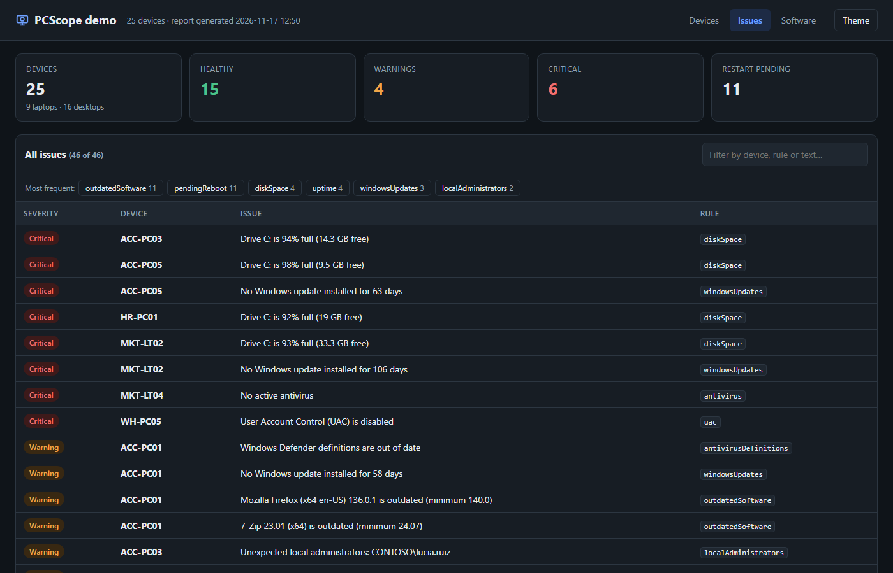
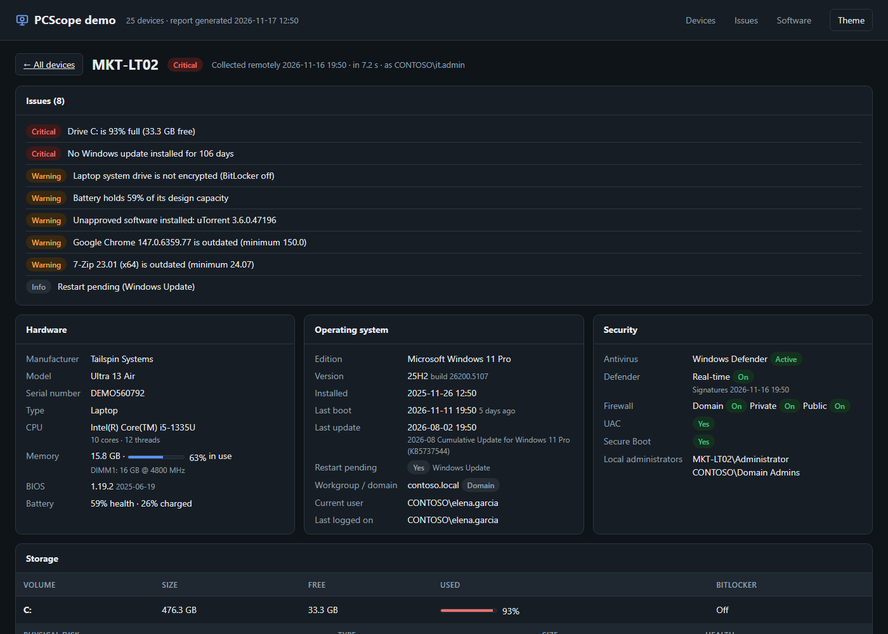

# PCScope

[](https://github.com/DavidGoRi/PCScope/actions/workflows/ci.yml)
[](https://davidgori.github.io/PCScope/)


**Inventory and health check for the Windows computers of a small office, in one minute and without installing anything.**

PCScope collects a read-only inventory of each PC (hardware, disks, Windows, security, network and installed software) and turns it into a single HTML dashboard that highlights what needs attention: a disk about to fill up, a laptop without encryption, a machine with no antivirus or months without updates.

### ▶ [Open the live demo](https://davidgori.github.io/PCScope/)

The demo shows a fleet of 25 fictitious devices, regenerated every week by GitHub Actions. Nothing to install: it is the same single HTML file PCScope produces.

*Leer en [español](README.es.md).*


## Why

Many small businesses do not have an up-to-date list of their computers, let alone know which ones are at risk. Commercial RMM tools solve this but cost money and need agents installed everywhere. PCScope uses only what Windows already includes:

- **Nothing to install.** Plain PowerShell 5.1 (included in every Windows 10/11) and a static HTML file.
- **Read-only.** It never changes any setting on the computers it inspects.
- **Works without administrator rights.** Every section is collected independently; if something cannot be read, it is reported and the rest carries on.
- **Works offline.** The dashboard is one self-contained file with no external libraries or CDNs: open it from a USB stick or a network share.

## Features

| Area | What PCScope collects |
|---|---|
| Hardware | Manufacturer, model, serial number, BIOS, CPU, RAM and memory modules, laptop or desktop |
| Storage | Volumes with free space and BitLocker state; physical disks with type, bus and SMART health |
| Battery | Charge and health (current full-charge capacity vs. design capacity) |
| Windows | Edition, version and build, install date, uptime, last installed update, pending restart and why |
| Security | Antivirus products (Defender and third-party) and whether they are active and up to date, firewall profiles, UAC, Secure Boot, members of the local Administrators group |
| Network | Active adapters with IPv4/IPv6, MAC, gateway, DNS and DHCP/static |
| Users | Current and last logged-on user |
| Software | Installed programs with version, publisher and install date (from the registry, avoiding the slow `Win32_Product`) |

The dashboard then:

- Evaluates **18 configurable health rules** and flags each device as *critical*, *warning* or *OK* (see [Health rules](#health-rules)).
- Shows a sortable, filterable table of every device and a full detail page for each one.
- Lists **every issue across the fleet** in one place, with the most frequent problems one click away.
- Answers questions like *"which computers still have an old Chrome?"* or *"where is TeamViewer installed?"* with a software search across all devices.
- Supports light and dark themes and works on mobile. Each tab has its own link (`#issues`, `#software`, `#device=NAME`).





## Health rules

Rules live in [`rules.json`](rules.json), so each organisation can tune thresholds or turn checks off without touching the code. A rule with `"enabled": false`, or missing from the file, is skipped.

| Rule | Default | Level |
|---|---|---|
| `diskSpace` | Volume over 80 % / 90 % full | warning / critical |
| `diskHealth` | Physical disk not reporting *Healthy* (SMART) | critical |
| `antivirus` | No active antivirus (Defender or third-party) | critical |
| `antivirusDefinitions` | Definitions out of date or older than 7 days | warning |
| `firewall` | Any firewall profile disabled | warning |
| `uac` | User Account Control disabled | critical |
| `windowsUpdates` | No update installed for 30 / 60 days | warning / critical |
| `unsupportedWindows` | Build below 22000 (Windows 10, out of support since Oct 2025) | critical |
| `laptopEncryption` | Laptop system drive without BitLocker | warning |
| `batteryHealth` | Battery below 60 % of its design capacity | warning |
| `localAdministrators` | Administrators other than the allowed accounts | warning |
| `blockedSoftware` | Unapproved programs (e.g. torrent clients) | warning |
| `outdatedSoftware` | Programs below a minimum version (Chrome, Firefox, 7-Zip, Notepad++) | warning |
| `staleInventory` | Inventory older than 7 days | warning |
| `pendingReboot`, `uptime`, `memory`, `collectionErrors` | Restart pending, more than 14 days without restarting, less than 8 GB of RAM, sections that could not be read | info |

For example, to block remote-access tools and require at least 16 GB of RAM:

```json
"blockedSoftware": { "enabled": true, "level": "warning", "patterns": [ "uTorrent", "AnyDesk", "TeamViewer" ] },
"memory":          { "enabled": true, "level": "info", "minGB": 16 }
```

Rules are evaluated in PowerShell ([`src/Rules.ps1`](src/Rules.ps1)), not in the browser, so the same results are available from the console:

```powershell
. .\src\Rules.ps1
$inventory = Get-Content .\output\data\PC01.json -Raw | ConvertFrom-Json
Get-PCScopeIssue -Inventory $inventory -RuleSet (Get-PCScopeRuleSet .\rules.json)
```

## Quick start

```powershell
git clone https://github.com/DavidGoRi/PCScope.git
cd PCScope
powershell -ExecutionPolicy Bypass -File .\PCScope.ps1 -Open
```

The inventory is saved to `output\data\<COMPUTERNAME>.json` and the dashboard to `output\report.html`. The console also prints a summary:

```
Collecting inventory of OFFICE-PC01...
Saved C:\PCScope\output\data\OFFICE-PC01.json (94 programs, 4 s)
Status: WARNING (2 issue(s))
  [warning] Unexpected local administrators: OFFICE-PC01\jsmith
  [info] Restart pending (Windows Update)
Dashboard: C:\PCScope\output\report.html
```

## Collecting from a whole office

PCScope supports two approaches, which can be combined. Both save one JSON per computer in the same folder, and one command builds the dashboard:

| | **A. Remote collection (pull)** | **B. Scheduled task (push)** |
|---|---|---|
| How | IT runs PCScope once and it contacts every computer over PowerShell remoting | Each computer runs PCScope on a schedule and writes to a shared folder |
| Install on the computers | Nothing | A local copy in `C:\ProgramData\PCScope` and a task |
| Needs | WinRM enabled and an admin account on the targets | A share where computer accounts can write |
| Best for | Ad-hoc audits, offices with WinRM already on | Laptops that are often away; regular reports with no one involved |

### A. Remote collection over WinRM

```powershell
# A few computers
.\PCScope.ps1 -ComputerName PC01, PC02, SALES-LT07 -Open

# A list (one name per line, # for comments) with a specific account
.\PCScope.ps1 -ComputerListPath .\computers.txt -Credential (Get-Credential CONTOSO\it.admin) -Open
```

Nothing is copied to the targets: the collector code travels with the request, runs there and only the JSON comes back. All computers are contacted in parallel (`-ThrottleLimit`, 32 by default). Unreachable computers are listed with the reason and saved to `failed-computers.txt`, ready to retry with `-ComputerListPath`.

```
Collecting inventory of 3 computer(s) over PowerShell remoting...
  [OK]     PC01 (4.1 s)
  [OK]     PC02 (5.3 s)
  [FAILED] SALES-LT07: Connecting to remote server SALES-LT07 failed: WinRM cannot complete the operation...
Collected 2 of 3 computer(s).
```

**Prerequisites:** PowerShell remoting enabled on the targets (`Enable-PSRemoting`, or the Group Policy *Allow remote server management through WinRM* plus a firewall rule) and an account in their local Administrators group. In a workgroup, add the targets to `TrustedHosts` on the IT computer.

### B. Scheduled task on each computer

From an elevated PowerShell on each computer, or deployed with a Group Policy startup script:

```powershell
.\tools\Install-PCScopeTask.ps1 -OutputPath \\fileserver\it\pcscope            # daily at 09:30
.\tools\Install-PCScopeTask.ps1 -OutputPath \\fileserver\it\pcscope -Schedule AtStartup
.\tools\Install-PCScopeTask.ps1 -OutputPath \\fileserver\it\pcscope -WhatIf    # show what it would do
.\tools\Install-PCScopeTask.ps1 -Uninstall
```

The task `\PCScope\PCScope inventory`:

- runs as **SYSTEM**, so it works with nobody logged on and reads everything (battery capacity, BitLocker…);
- spreads the runs: up to 30 minutes of random delay for the daily trigger, 10 minutes after boot or logon, so the whole office does not hit the share at once;
- stops after 15 minutes, never runs twice at the same time and still runs on battery.

Because it runs as SYSTEM, the computer writes to the share with its own account (`CONTOSO\PC01$`): give **Domain Computers** *Modify* permission on the data folder only, and keep the dashboard somewhere only IT can read.

### Building the dashboard

```powershell
.\PCScope.ps1 -OutputPath \\fileserver\it\pcscope -ReportOnly -Open
```

Each device page says how it was collected: locally, remotely or by the scheduled task.

### Parameters

| Parameter | Description |
|---|---|
| `-OutputPath` | Results folder. Default: `.\output` |
| `-ComputerName` | Collect from these computers over PowerShell remoting |
| `-ComputerListPath` | Text file with one computer per line |
| `-Credential` | Account for the remote connections (default: current user) |
| `-ThrottleLimit` | Computers contacted at the same time. Default: 32 |
| `-NoReport` | Only collect and save the JSON |
| `-ReportOnly` | Do not collect; rebuild the dashboard from the existing JSON files |
| `-RulesPath` | Health rules file. Default: `rules.json` |
| `-Open` | Open the dashboard when finished |

The functions can also be used on their own:

```powershell
. .\src\Collector.ps1
Get-PCScopeInventory | ConvertTo-Json -Depth 8
```

## How it works

```
 PC 1 ─┐                                            rules.json
 PC 2 ─┼─► Collector.ps1 ─► <COMPUTERNAME>.json ─► Rules.ps1 + Report.ps1 ─► report.html
 PC n ─┘    (read-only)       (one per device)      (issues per device,      (self-contained,
                                                     data embedded in         no server)
                                                     the template)
```

- [`src/Collector.ps1`](src/Collector.ps1) – one function per section (`Get-PCScopeHardware`, `Get-PCScopeSecurity`…), built on CIM/WMI, the registry and built-in cmdlets. Each section runs inside its own error handler.
- [`src/Remote.ps1`](src/Remote.ps1) – sends the collector source to remote computers with `Invoke-Command`, saves each JSON and reports which computers failed and why.
- [`src/Task.ps1`](src/Task.ps1) – installs and removes the scheduled task (copy, action, trigger, SYSTEM principal and settings).
- [`src/Rules.ps1`](src/Rules.ps1) – evaluates [`rules.json`](rules.json) against an inventory and returns its issues, most severe first.
- [`src/Report.ps1`](src/Report.ps1) – validates every JSON file, skips broken ones and embeds the data and issues in the template. Data is escaped so that text like `</script>` in a device name cannot break or inject code into the page.
- [`src/report-template.html`](src/report-template.html) – the dashboard: vanilla HTML, CSS and JavaScript, no dependencies.
- [`tools/New-DemoFleet.ps1`](tools/New-DemoFleet.ps1) – generates fictitious devices with the same schema, used by the live demo and the tests. The same seed always produces the same fleet.

Some details that took care to get right:

- The local Administrators group is located by its well-known SID (`S-1-5-32-544`) because its name changes with the Windows language (*Administradores*, *Administrateurs*…).
- BitLocker state is read through the shell property `System.Volume.BitLockerProtection`, which unlike `Get-BitLockerVolume` does not need administrator rights.
- Windows PowerShell 5.1 serializes dates as `\/Date(…)\/` and unrolls one-item arrays; PCScope converts dates to ISO 8601 and keeps lists as JSON arrays (both covered by tests).
- Defender may report "real-time protection off" simply because another antivirus is active, so the antivirus check uses Windows Security Center instead.
- Scheduled-task boot and logon triggers silently ignore `-RandomDelay`; PCScope sets their `Delay` property instead (found by a test).
- .NET file APIs resolve relative paths against the process directory, not the PowerShell location, so every path is resolved with `GetUnresolvedProviderPathFromPSPath` first.

## Privacy

The JSON files and the dashboard contain serial numbers, IP and MAC addresses, user names and the list of installed software. Store them somewhere only IT can read. PCScope never stores credentials: remote collection uses the current session or a `-Credential` typed at run time, and the scheduled task uses the computer's own account. The `output/` folder is excluded in `.gitignore` so real data is never committed; the screenshots and the live demo use fictitious devices generated by [`tools/New-DemoFleet.ps1`](tools/New-DemoFleet.ps1).

## Development

```powershell
Install-Module Pester -MinimumVersion 5.5 -Scope CurrentUser -SkipPublisherCheck
Install-Module PSScriptAnalyzer -Scope CurrentUser

Invoke-ScriptAnalyzer -Path . -Recurse -Settings .\PSScriptAnalyzerSettings.psd1
Invoke-Pester -Path .\tests -Output Detailed
```

GitHub Actions runs both on Windows PowerShell 5.1 for every push and pull request ([`ci.yml`](.github/workflows/ci.yml)), and a second workflow ([`demo.yml`](.github/workflows/demo.yml)) rebuilds and publishes the live demo to GitHub Pages.

To try the dashboard with fictitious data locally:

```powershell
.\tools\New-DemoFleet.ps1 -OutputPath .\output\demo\data -Count 25
.\PCScope.ps1 -OutputPath .\output\demo -ReportOnly -Open
```

## Roadmap

- [x] Read-only collector, JSON output and self-contained dashboard
- [x] Health rules in a configurable `rules.json` (thresholds, enable/disable checks)
- [x] Live demo on GitHub Pages with a generated fleet of fictitious devices
- [x] Remote collection with `Invoke-Command` (WinRM) and a scheduled-task installer
- [ ] History: detect changes between runs (new software, RAM changes, disk growth)
- [ ] CSV export and optional email/Telegram alerts for critical issues

## License

[MIT](LICENSE)
