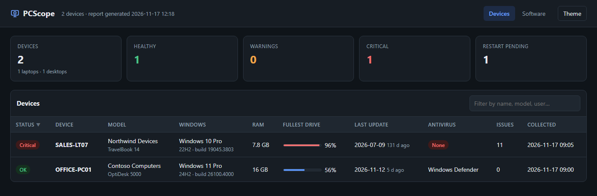

# PCScope

[](https://github.com/DavidGoRi/PCScope/actions/workflows/ci.yml)


**Inventory and health check for the Windows computers of a small office, in one minute and without installing anything.**

PCScope collects a read-only inventory of each PC (hardware, disks, Windows, security, network and installed software) and turns it into a single HTML dashboard that highlights what needs attention: a disk about to fill up, a laptop without encryption, a machine with no antivirus or months without updates.

*Leer en [español](README.es.md).*



## Why

Many small businesses do not have an up-to-date list of their computers, let alone know which ones are at risk. Commercial RMM tools solve this but cost money and need agents installed everywhere. PCScope uses only what Windows already includes:

- **Nothing to install.** Plain PowerShell 5.1 (included in every Windows 10/11) and a static HTML file.
- **Read-only.** It never changes any setting on the computers it inspects.
- **Works without administrator rights.** Every section is collected independently; if something cannot be read, it is reported and the rest carries on.
- **Works offline.** The dashboard is one self-contained file with no external libraries or CDNs: open it from a USB stick or a network share.

## Features

| Area | What PCScope collects |
|---|---|
| Hardware | Manufacturer, model, serial number, BIOS, CPU, RAM and memory modules, laptop or desktop |
| Storage | Volumes with free space and BitLocker state; physical disks with type, bus and SMART health |
| Battery | Charge and health (current full-charge capacity vs. design capacity) |
| Windows | Edition, version and build, install date, uptime, last installed update, pending restart and why |
| Security | Antivirus products (Defender and third-party) and whether they are active and up to date, firewall profiles, UAC, Secure Boot, members of the local Administrators group |
| Network | Active adapters with IPv4/IPv6, MAC, gateway, DNS and DHCP/static |
| Users | Current and last logged-on user |
| Software | Installed programs with version, publisher and install date (from the registry, avoiding the slow `Win32_Product`) |

The dashboard then:

- Flags issues by severity: **critical** (disk over 90 %, failing disk, no active antivirus, no updates in 60 days, UAC off), **warning** (disk over 80 %, firewall off, unencrypted laptop, worn battery, no updates in 30 days) and **info** (pending restart, long uptime, low RAM).
- Shows a sortable, filterable table of every device and a full detail page for each one.
- Answers questions like *"which computers still have an old Chrome?"* or *"where is TeamViewer installed?"* with a software search across all devices.
- Supports light and dark themes and works on mobile.


## Quick start

```powershell
git clone https://github.com/DavidGoRi/PCScope.git
cd PCScope
powershell -ExecutionPolicy Bypass -File .\PCScope.ps1 -Open
```

The inventory is saved to `output\data\<COMPUTERNAME>.json` and the dashboard to `output\report.html`.

### A whole office

Run PCScope on each computer pointing to the same shared folder (for example from a logon script or a scheduled task), then build the dashboard once:

```powershell
# On every computer
.\PCScope.ps1 -OutputPath \\fileserver\it\pcscope -NoReport

# Once, from the IT computer
.\PCScope.ps1 -OutputPath \\fileserver\it\pcscope -ReportOnly -Open
```

### Parameters

| Parameter | Description |
|---|---|
| `-OutputPath` | Results folder. Default: `.\output` |
| `-NoReport` | Only collect and save the JSON |
| `-ReportOnly` | Do not collect; rebuild the dashboard from the existing JSON files |
| `-Open` | Open the dashboard when finished |

The functions can also be used on their own:

```powershell
. .\src\Collector.ps1
Get-PCScopeInventory | ConvertTo-Json -Depth 8
```

## How it works

```
 PC 1 ─┐
 PC 2 ─┼─► Collector.ps1 ─► <COMPUTERNAME>.json ─► Report.ps1 ─► report.html
 PC n ─┘    (read-only)       (one per device)      (embeds the     (self-contained,
                                                    JSON in the      no server)
                                                    template)
```

- [`src/Collector.ps1`](src/Collector.ps1) – one function per section (`Get-PCScopeHardware`, `Get-PCScopeSecurity`…), built on CIM/WMI, the registry and built-in cmdlets. Each section runs inside its own error handler.
- [`src/Report.ps1`](src/Report.ps1) – validates every JSON file, skips broken ones and embeds the data in the template. Data is escaped so that text like `</script>` in a device name cannot break or inject code into the page.
- [`src/report-template.html`](src/report-template.html) – the dashboard: vanilla HTML, CSS and JavaScript, no dependencies.

Some details that took care to get right:

- The local Administrators group is located by its well-known SID (`S-1-5-32-544`) because its name changes with the Windows language (*Administradores*, *Administrateurs*…).
- BitLocker state is read through the shell property `System.Volume.BitLockerProtection`, which unlike `Get-BitLockerVolume` does not need administrator rights.
- Windows PowerShell 5.1 serializes dates as `\/Date(…)\/` and unrolls one-item arrays; PCScope converts dates to ISO 8601 and keeps lists as JSON arrays (both covered by tests).
- Defender may report "real-time protection off" simply because another antivirus is active, so the antivirus check uses Windows Security Center instead.

## Privacy

The JSON files and the dashboard contain serial numbers, IP and MAC addresses, user names and the list of installed software. Store them somewhere only IT can read. The `output/` folder is excluded in `.gitignore` so real data is never committed; the screenshots above use fictitious devices from [`tests/fixtures`](tests/fixtures).

## Development

```powershell
Install-Module Pester -MinimumVersion 5.5 -Scope CurrentUser -SkipPublisherCheck
Install-Module PSScriptAnalyzer -Scope CurrentUser

Invoke-ScriptAnalyzer -Path . -Recurse -Settings .\PSScriptAnalyzerSettings.psd1
Invoke-Pester -Path .\tests -Output Detailed
```

GitHub Actions runs both on Windows PowerShell 5.1 for every push and pull request.

## Roadmap

- [x] Read-only collector, JSON output and self-contained dashboard
- [ ] Health rules in a configurable `rules.json` (thresholds, enable/disable checks)
- [ ] Live demo on GitHub Pages with a generated fleet of fictitious devices
- [ ] Remote collection with `Invoke-Command` (WinRM) and a scheduled-task installer
- [ ] History: detect changes between runs (new software, RAM changes, disk growth)
- [ ] CSV export and optional email/Telegram alerts for critical issues

## License

[MIT](LICENSE)
